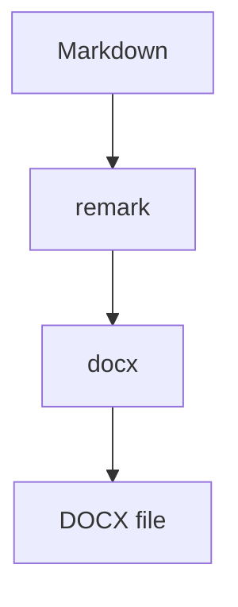

# markdown-to-doc Feature Showcase

This document exercises every Markdown construct and package option supported today. Open the generated DOCX in Word to see how each one renders.

## Text Formatting

Plain body text uses the `Normal` style. Inline formatting is applied directly: **bold**, *italic*, ***bold italic***, ~~strikethrough~~, and `inline code`. Raw HTML works for a fixed subset, so <u>underline</u>, <b>bold</b>, <i>italic</i>, and <s>strike</s> are also fine.

Links keep the `Hyperlink` character style: [package repository](https://github.com/Nilesh9106/markdown-to-doc). A hard line break  
splits this paragraph onto a second line.

### Heading Level 3

#### Heading Level 4

Headings one to four map to Word's `Heading 1` to `Heading 4` styles, so they show up in the navigation pane and the table of contents.

---

## Lists

### Unordered

- Top-level bullet
- Another bullet with **bold** text
  - Nested bullet
    - Third level
- Back to the top level

### Ordered

1. First step
2. Second step
   1. Nested numbered step
   2. Another nested step
3. Third step

### Task Lists

- [x] Named Word styles
- [x] Math and diagram rendering
- [x] Template inheritance
- [x] Footnotes
- [ ] Captions with automatic numbering

## Blockquotes

> Markdown controls the content. Configuration controls the layout and appearance.
>
> Quotes use the `Quote` style with a left border and background from the theme.

## Code

Fenced blocks with a known language are syntax highlighted inside the `SourceCode` style:

```ts
export async function convert(markdown: string): Promise<Buffer> {
  const buffer = await markdownToDocx(markdown, { toc: { show: true } });
  return buffer; // ready to write to disk
}
```

Unknown languages fall back to plain monospace:

```brainflux
spark -> pulse -> sink
```

## Diagrams

A `mermaid` fence is handed to the `codeBlockRenderers.mermaid` hook. The example script returns a placeholder image; wire in a real renderer to get the diagram.



## Math

Inline math such as $E = mc^2$ and $\frac{a}{b}$ stays inside the sentence as a native Word equation. Display math gets its own centered equation paragraph:

$$
\int_0^1 x^2 \, dx = \frac{1}{3}
$$

$$
\sum_{i=1}^{n} i = \frac{n(n+1)}{2}
$$

## Tables

| Feature | Status | Notes |
| :--- | :---: | ---: |
| Named styles | Done | Restyle in Word's style pane |
| Math | Done | OMML equations |
| Diagrams | Hook | Caller renders the image |
| Footnotes | Done | Native Word footnotes |

Header rows use the `TableHeader` style; body cells use `TableCell`, with striped rows from the theme.

## Images

A local image resolved relative to the examples folder:


A remote image handled by the `assets.resolveImage` callback in the example script:


## Footnotes

The settlement window is two business days.[^1] Footnotes are numbered by first reference,[^details] and repeated references reuse the same number.[^1]

[^1]: Excluding bank holidays in the originating jurisdiction.
[^details]: Footnotes can contain **formatting**, [links](https://example.com), and lists:

    - nested item one
    - nested item two

## Raw HTML Blocks

<p>A paragraph written in HTML with <a href="https://example.com">a link</a> and <code>code</code>.</p>

<ul>
  <li>HTML list item one</li>
  <li>HTML list item two</li>
</ul>

<hr>

## Horizontal Rules

Three dashes above and below render as a bottom-bordered paragraph.

---

That is everything the package renders today. Headers, footers, cover page, table of contents, page setup, theme, and template inheritance are configured in `examples/markdown-to-docx.ts`.
